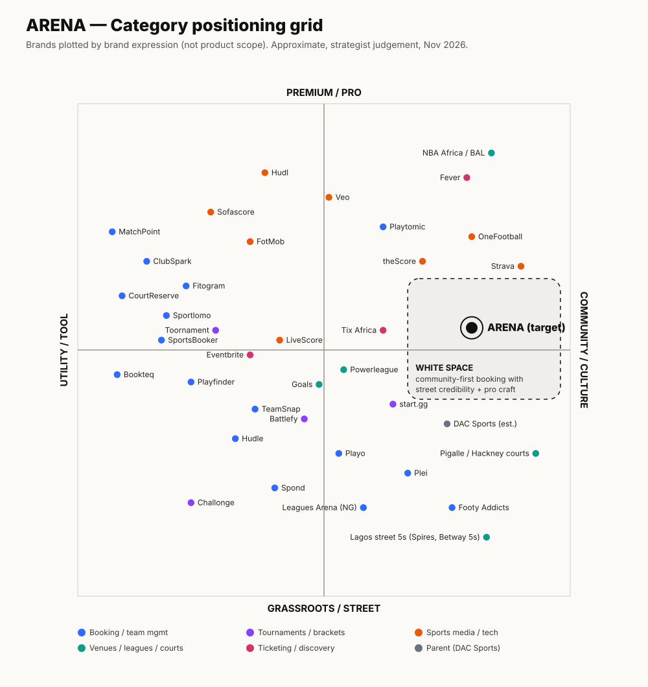

# ARENA — Competitive & Category Audit

**Date:** 22 Nov 2026 · **Phase:** 01 Research · **Companion files:** `positioning_grid.svg`, `app_store_and_specs.md`

## How to read this

- **Evidence level.** Live web checks were used for the facts flagged ✔ (search/fetch, sources at the end). Visual descriptions (palette hex, type, icons) come from the strategist's own knowledge of these brands as of 2025–26. They are **approximations**, given to map colour *territories*, not to copy. Confidence is marked **H / M / L**.
- **Blocked fetches.** `www.instagram.com`, `support.google.com` and `buffer.com` did not resolve from this session, so the DAC Sports Instagram grid could not be viewed (see section 4b).
- **Mark types:** W = wordmark, S = symbol, C = combination (symbol + wordmark), M = monogram/lettermark.

---

## 1. Brand audit (38 brands)

### 1a. Sports-venue booking & team management

| Brand | Type | Core shape idea | Palette (approx.) | Typography | App icon | What works | ARENA must avoid | Conf. |
|---|---|---|---|---|---|---|---|---|
| **Playtomic** (ES, global padel/tennis) | W (lowercase) | Soft, rounded lowercase wordmark; no symbol. Energy comes from photography and UI | Deep navy `#0B1E3A`, electric lime/yellow-green accent `#D4FF3A`, white | Rounded geometric sans, friendly | "p"-style glyph on dark field | Owns padel culture. Premium but approachable. The wordmark carries the brand | Lime-on-navy, a racquet-sport "club" look. It is the closest global competitor in tone | M |
| **Playfinder** (UK) | C | Location/finder cue with a sporty wordmark | Teal/green `#00B488`, navy | Bold sans | Green tile with a white mark | Clear "find a pitch" promise | Green "pitch" field, a pin-as-logo | L |
| **MatchPoint** (club SaaS) | C | Ball/point cue | Blues `#1C4FA0` and a sport accent | Corporate sans | Ball + letter | Credible for B2B | SaaS-blue corporate anonymity | L |
| **CourtReserve** (US) | C | Court lines + ball | Blue `#1E5AA8`, green `#7BC043` | Plain sans | Court/ball glyph | Operator trust | Literal court lines + tennis ball | M |
| **SportsBooker** | W/C | Calendar or ball | Blue/white | Generic sans | Letter on blue | Functional | Being invisible | L |
| **Hudle** (IN) | C | Huddle/people cue | Green-teal plus a secondary | Rounded sans | Letter "h" tile | Social "huddle" naming | Rounded-letter-in-tile genericness | L |
| **Playo** (IN) | W | Lowercase wordmark; the "o" reads as a ball/target | Green `#00B24F`, white | Rounded bold sans | Green tile with white "playo"/"p" | Community framing ("find players") at Asian scale. The nearest model for ARENA's product | Grass-green + ball-as-letter. The most-copied trope in emerging markets | M |
| **ClubSpark** (LTA/UK) | C | Spark/star burst | Teal `#00A0AF`, navy | Humanist sans | Spark on teal | Federation-grade trust | Institutional coolness, spark clichés | M |
| **Spond** (NO) | W/C | Rounded speech/people cue | Bright coral-red/orange accents on white (approx. `#FF5A4E`) | Rounded sans | Simple white mark on colour | Warm, parent-friendly | Coral/red (clashes with ARENA's red = Fully Booked) | L |
| **TeamSnap** (US) | C | Snap/burst + wordmark | Orange `#FF8F1C`, charcoal | Heavy rounded sans | Orange tile | Ownership of youth-sport orange | Orange (very crowded, see below) | H |
| **Sportlomo** (IE) | C | Shield-ish/sport cue | Blue `#0057B8` | Corporate sans | Blue tile | Governing-body credibility | Shield/crest clichés | L |
| **Footy Addicts** (UK) | C | Football + bold wordmark | Green/black, white | Condensed bold | Ball icon | A "just turn up and play" community | Ball icon + green | L |
| **Plei** | W | Playful wordmark | Bright, youthful | Rounded | Letter tile | Casual, social tone | Childish roundness | L |
| **Kickoff-type / 5-a-side apps** (generic) | C | Ball, boot, whistle, pitch rectangle | Neon green `#39FF14` on black `#0A0A0A` | Italic condensed "speed" type | Ball on pitch | Instant category read | **Everything here is the trope list** | M |
| **Bookteq** (UK) | W | Tech-y wordmark ("teq") | Blue/teal | Geometric sans | Wordmark crop | Operator efficiency | B2B SaaS sameness | L |
| **Fitogram** (now part of Eversports) | W/C | Soft lowercase | Teal-green | Rounded sans | Letter tile | Clean studio-booking UX | Wellness softness (wrong energy for street sport) | L |
| **Leagues Arena** ✔ (NG, Abuja) | C (unverified) | — | Unverified | — | — | Already does Nigerian leagues, cups and **venue booking**, and plans to cover 36 states, then Africa | **Name collision: "Arena" in the same market and category** (see section 5) | ✔ existence / L visuals |
| **Padel x Nigeria** ✔ (iOS app) | C (unverified) | Padel | Unverified | — | — | Shows padel booking demand in NG | Racquet + ball clichés | ✔ existence |

### 1b. Tournament / bracket platforms

| Brand | Type | Core shape idea | Palette | Typography | App icon | What works | Avoid | Conf. |
|---|---|---|---|---|---|---|---|---|
| **Challonge** | C | Bracket lines | Orange `#FF7324`, dark grey | Bold sans | Bracket glyph on orange | A bracket is a strong, ownable *diagram* | Literal bracket-as-logo; orange | M |
| **Battlefy** | W/C | Angular "B" | Red `#E2342C`, black | Aggressive angular sans | "B" on dark | Esports energy | Red + black "gamer" angularity | L |
| **start.gg** | S + W | Four-square quadrant (red/blue) | Red `#E0383E`, blue `#2E6DB4`, dark | Clean sans | Quadrant square | A simple geometric symbol scales perfectly | Red/blue "versus" split | M |
| **Toornament** | W/C | Trophy/bracket cue | Navy + orange | Sans | Letter tile | Organiser-grade tooling | Trophy icon cliché | L |

### 1c. Sports-tech & media

| Brand | Type | Core shape idea | Palette | Typography | App icon | What works | Avoid | Conf. |
|---|---|---|---|---|---|---|---|---|
| **Strava** | W + S (chevrons) | Stacked chevrons = route/peaks | Orange `#FC4C02`, white | Heavy custom sans, caps | White chevrons on orange | **The gold standard of community-in-sport**: segments, kudos, local leaderboards. A tiny, ownable abstract symbol | Orange; "fitness-tracker" coolness | H |
| **Hudl** | W | Lowercase wordmark | Orange `#FF6300`, black | Bold geometric sans | Orange tile with white wordmark | Pro-team credibility, applied to amateurs | Orange again | H |
| **Veo** | W | Minimal wordmark | Black, white, accent lime/green | Clean grotesk | Monochrome tile | Premium camera hardware feel | Lime accent on black | M |
| **OneFootball** | C | "1" + ball/cut motif | Black `#000`, white | Bold grotesk | White mark on black | Black/white confidence; editorial | Ball-in-numeral trope | M |
| **FotMob** | W/C | Lowercase + ball cue | Green `#00985F` / dark mode | Rounded sans | Green tile | Data-dense yet friendly | Pitch green | M |
| **Sofascore** | C | Abstract S / bolt | Blue `#374DF5`, dark navy | Modern grotesk | White glyph on blue | Strong, flat, scalable symbol | Electric blue (crowded across data apps) | M |
| **LiveScore** | W | Lowercase "livescore" | Orange `#FF7700` on near-black | Bold sans | Orange "LS"/wordmark on black | "Live" credibility | "Live" = orange on black. ARENA's "Live Now" must not borrow this | M |
| **theScore** | W | Lowercase "the score" | Black/white with accent | Grotesk | White on black | Editorial, culture-forward | Generic black/white with no ownable symbol | L |

### 1d. Venues, stadiums, leagues & courts

| Brand | Type | Core shape idea | Palette | Typography | App icon | What works | Avoid | Conf. |
|---|---|---|---|---|---|---|---|---|
| **Powerleague** (UK) | C | Ball/energy swoosh + wordmark | Purple/navy with bright accent | Bold italic | — | Venue network + leagues = ARENA's supply side | Italic "speed" swooshes | L |
| **Goals Soccer Centres** (UK) | W/C | Bold "GOALS" | Red/yellow or green | Heavy caps | — | Plain, confident naming | Pitch-rectangle imagery | L |
| **Pigalle Duperré / Hackney-Wick-style art courts** | Environmental | The **court itself as a canvas**: colour-blocked floors, murals | Saturated non-sport colours (violet, coral, cobalt, sun-yellow) | Fashion/editorial | n/a | **The richest cue for ARENA**: local courts as culture and design objects | Copying one specific court's palette | H (concept) |
| **NBA Africa / Basketball Africa League (BAL)** | C | Basketball + continent; NBA logoman lineage | Black, red `#C8102E`, blue `#1D428A`, warm orange | Strong condensed caps | — | Continental pride, premium production | Africa-map silhouettes, basketball seams | M |
| **Betway 5s League** ✔ (NG; described as Nigeria's first organised 5-a-side competition) | C | Sponsor-led | Betway black + green `#00A826` | Bold sans | — | Proof of 5s demand | **Betting-brand green on black** | ✔ / M |
| **Spires 5-Aside Naija Street Soccer** ✔ (Lagos, season 3) | C (unverified) | Street tournament | Unverified | — | — | Five Lagos divisions, 40 teams, street credibility | Gritty-street clichés (graffiti brush type) | ✔ / L |
| **Lagos 5s hot-spots** ✔ (Oshodi, Ikeja, Ajegunle; new turfs at Ojodu and Alimosho/Alade, Kings Turf) | Venues | Concrete/astroturf cages | Turf green, fence silver, sponsor colours | Hand-painted / sponsor | — | Real, dense grassroots supply ARENA can digitise | Turf-green + fence-mesh literalism | ✔ / M |
| **Olumo Super Liga** ✔ (NG, on Sofascore's Torneo) | — | — | — | — | — | Shows Nigerian grassroots leagues are adopting global tournament tech, so ARENA brackets compete with Torneo | — | ✔ |

> I could not verify any Lagos venue brand called "Monarchs". Treat it as unconfirmed.

### 1e. Maps, discovery & ticketing

| Brand | Type | Core shape idea | Palette | Typography | App icon | What works | Avoid | Conf. |
|---|---|---|---|---|---|---|---|---|
| **Eventbrite** | W (+ "e" mark) | Lowercase wordmark; "e" icon | Orange `#F05537`, navy `#1E0A3C` | Custom rounded sans | Orange "e" | Warm, human | Orange | H |
| **Fever** | W | Bold wordmark | Black/white with hot accents | Display sans | Wordmark tile | Curated, aspirational "things to do" | Nightlife-only gloss | L |
| **Tix Africa** (NG) | W/C | Ticket cue | Purple/violet family (approx.) | Rounded sans | Letter tile | Local ticketing trust | Ticket-stub clichés | L |
| **Google Maps / Apple Maps** (pattern) | S | **The map pin** | Multicolour / blue | System | Pin / folded map | Universal "near me" grammar | **Pin-as-logo**: every local-discovery app uses it | H |

### 1f. Parent

| Brand | Type | Notes |
|---|---|---|
| **DAC Sports** (@dacsports_) | Unverified | Instagram did not resolve from this session, and the web search returned no indexed results. See section 4b. |

---

## 2. Positioning grid

**Axes.** X runs from Utility/Tool (booking SaaS, scores, brackets) to Community/Culture (identity, belonging, content). Y runs from Grassroots/Street to Premium/Pro.

**Reading.**
- **Top-left (premium utility)** is saturated: Hudl, Sofascore, FotMob, MatchPoint, ClubSpark, CourtReserve. These are blue, orange and green tools with low emotion.
- **Bottom-left (grassroots utility)** holds Challonge, Spond, Hudle, Bookteq, Playfinder and TeamSnap. It is functional and forgettable.
- **Bottom-right (grassroots culture)** is real but **unbranded or sponsor-branded**: Lagos street 5s, Footy Addicts, Plei, Pigalle-type courts. The culture lives here, but no product owns it, and in Nigeria the betting sponsors own it visually.
- **Top-right (premium culture)** belongs to media and entertainment (NBA Africa/BAL, Fever, OneFootball, Strava). **None of them sells you a slot on a pitch tonight.**

**Where ARENA should sit:** right of centre, slightly above the midline (≈ +6, +1). ARENA should be **community-first, culture-coded, and crafted like a premium brand, but priced and voiced for the street.** It should feel like Strava's social layer and Pigalle's court-as-canvas attitude, with Playtomic-level polish, rooted in Lagos 5s energy.

**The white space:** *a booking platform that is also the identity of local sport.* Booking competitors sit left (tools). Culture brands sit right but don't transact. ARENA bridges the two, and the "Live Now" map is the hinge: it is utility (find a free court) **and** culture (see where the game is, right now).

---

## 3. Synthesis

1. **The category has two visual dialects. Both are exhausted.**
   - *Pitch dialect:* grass green, ball icons, court lines, whistles, italic speed type. Booking apps and 5-a-side brands.
   - *Hype dialect:* neon lime on black, aggressive angular type, gradients. Esports, betting and kit brands.
2. **Orange is taken by "live/community sport tech"** (Strava, Hudl, TeamSnap, LiveScore, Eventbrite, Challonge).
3. **Blue is taken by "trusted tool"** (Sofascore, CourtReserve, ClubSpark, SportsBooker, Sportlomo, Paystack/Stripe UI).
4. **In Nigeria, sport + green or sport + red reads as a betting app.** Bet9ja and Betway are green, SportyBet is red, and betting sponsors dominate 5s leagues. ARENA needs trust with parents, venue owners and payments, so it must not look like a bookie.
5. **ARENA's own status system already claims green, amber, red and gray.** The brand primary must sit **outside** those four hues. Otherwise "brand colour" and "Fully Booked" or "Available" will be confused on the map.
6. The strongest marks in the set are **simple abstract symbols with one idea** (Strava chevrons, start.gg quadrant, Sofascore glyph). Literal sport pictograms are weak and interchangeable.
7. **The ownable idea for ARENA is the *place*, not the ball.** An arena is a bounded space where people gather and play: a ring, an enclosure, a court seen from above, a stage. The idea is sport-agnostic, which ARENA needs across five sports.

## 4. White space for ARENA

- **Positioning:** the culture brand of local play. "Where the game is, right now." Community-first, multi-sport, Africa-born and globally fluent.
- **Shape territory (open):** the *enclosure/ring/stage*, an abstract bounded space seen from above. Options include a rounded-square "court" with an open gate, concentric rings showing "live" pulse/gathering, or an A built from an arena bowl rather than a triangle. One idea, flat, legible at 29 px and in iOS tinted/clear modes.
- **Colour territory (open):** **ultraviolet / electric indigo** (≈ `#4B2BFF`–`#5B3DF5`) or **deep violet** with a warm, sun-baked neutral (sand/bone `#F3EEE4`) and ink `#0E0E12`. A secondary accent can be a **"laterite" clay/terracotta** (≈ `#C8553D`), kept clearly browner than status red, or a hot magenta for media. Violet is used by none of the booking leaders, is not a Nigerian party colour, does not read as betting, and sits clear of all four status colours.
- **Type territory (open):** a confident **wide or grotesk display** with an African-modern, editorial attitude (think fashion/music-label posters from Lagos), paired with a highly legible UI sans. Avoid italic "speed" condensed type and gamer angularity.
- **Imagery:** real Lagos courts and players at golden hour, colour-graded consistently. Flash-lit night games. The court as a graphic object (Pigalle lineage). Not stock athletes.
- **Endorsement:** "ARENA by DAC Sports" as a small sub-line lock-up. ARENA leads, DAC endorses.

## 4b. DAC Sports (parent): endorsement without copying

**What was verified:** nothing visual. `instagram.com/dacsports_` did not resolve from this session, and a web search for "DAC Sports" / "dacsports_" returned no indexed press or site. **Action:** someone with access should screenshot the profile picture, the latest 12 posts and the highlight covers into `01_Research/references/dac_sports/`. Then record:
- mark type (likely a "DAC" lettermark, which is typical for initial-based holding brands)
- primary colours (hex picked from the avatar)
- typeface feel (condensed sports caps vs. clean grotesk)
- photo style

**Endorsement rules, whatever DAC looks like:**
1. **Separate the hierarchy.** ARENA is the hero brand with its own symbol and colour. DAC Sports appears only as a small text endorsement: "ARENA by DAC Sports" in a single neutral weight, using either DAC's own logotype or ARENA's UI sans.
2. **Contrast by design.** If DAC is a lettermark in a sports-heritage palette (e.g. black/red/gold or a national green), ARENA keeps its abstract symbol and violet/bone palette. Never recolour ARENA into DAC colours, and never put the DAC monogram inside the ARENA icon.
3. **One shared device at most.** Share neutral ink black and the clear-space system so the two lock up tidily. Don't share symbols or accent colours.
4. **Placement:** use the endorsement on the splash end-frame, store "Developer" line, website footer, press and B2B venue materials. Keep it out of the app icon and most social posts.
5. **Watch the acronym.** "DAC" is one letter-swap from **ADC** (African Democratic Congress, a political party). Keep "DAC Sports" written in full, never "DAC" alone, in public endorsements.

## 5. Name check: "Arena" crowding

"Arena" is a **dictionary word, heavily used in sport**, so trademark protection for the word alone will be weak. Distinctiveness must come from the mark, the descriptor and the trade dress.

| Name | Field | Risk |
|---|---|---|
| **Leagues Arena** ✔ | Nigerian football leagues, team mgmt, **venue booking**; expanding to 36 states, then Africa | **High.** Same market, same function, overlapping word |
| **ArenaGo** ✔ | App for booking football, padel and tennis courts | High (same function) |
| **Arena Sports Network** ✔ | US app: book youth camps, lessons and training ("keep sports simple with Arena") | Medium |
| **Arena** (Bahrain, iOS, Sports) ✔ | Sports app in the Gulf/MENA | Medium (regional) |
| **Sport Arena** ✔ (IT, social sport events), **Arena Sport Club** ✔ | Sports social/clubs | Medium |
| **ArenaX** ✔, **Arenafriends** ✔, **Tournamaker Arena** ✔, **ARENA** (esports streaming) ✔ | Esports tournaments | Medium (tournament feature overlap) |
| **arena** (swimwear/sports apparel, global) | Classes 25/28 sporting goods; very strong mark | Medium for merch; avoid its sharp triangular "a" mark style |
| **Arena Club** (sports cards), **The Arena Group** (publisher), **Arena Football League**, **Are.na** (creative platform), **Arena Sports** (US indoor-soccer venues) | Adjacent | Low to medium; confirms crowding |

**Recommendations**
1. Run formal clearance (NG Trademarks Registry, WIPO Madrid/Global Brand DB, USPTO, EUIPO) in Classes **9, 41, 42, 35, 36** before finalising. This audit is not legal clearance.
2. Never ship the plain word alone. Pair it with a **distinctive symbol** and a **consistent descriptor**:
   - Recommended: **"ARENA — Play Local"** or **"ARENA · Find your game"**.
   - For the store name: **"ARENA: Book & Play Local Sport"**. This also helps App Store/Play search, because "Arena" alone returns dozens of apps.
3. Prefer a **custom-drawn wordmark** (modified letterforms) over a stock font so the trade dress is protectable.
4. Consider securing the "by DAC Sports" endorsement in filings to strengthen distinctiveness.
5. Handle/domain: expect `@arena` to be taken. Plan for `@arena.play`, `@playarena`, `@arenaafrica` or `@arena_ng`, and check availability.

## 6. Cultural notes (Nigeria)

*These are the strategist's knowledge and desk notes. Validate them with native Yoruba, Hausa, Igbo and Pidgin speakers before lock.*

**The word "arena"**
- **English/Pidgin:** understood as a sporting or gathering place, with a positive ring ("na for arena we go settle am"). No known slang meaning in Pidgin.
- **Yoruba:** no direct meaning. Nearby sounds are *ara* (body; also "wonder/feat" in *àrà*, as in "ṣe àrà", to do something remarkable) and *àrá* (thunder, linked with Ṣàngó). These are neutral to positive associations. Don't lean on Ṣàngó/orisha imagery, which is religious.
- **Hausa:** no direct meaning. *Aro/ara* relates to borrowing. Low risk.
- **Igbo:** **"ara" can mean madness** (*onye ara* = mad person) and also "breast", depending on tone. "Arena" is not pronounced as *ara*, so the risk is low. Still, **avoid truncating the brand to "ARA"** in campaigns, monograms or handles.
- **Hausa/Arabic-influenced north:** neutral.

**Shapes**
- Avoid **brooms, umbrellas, palm-tree or hoe-like forms and party-like emblems**. They read as political (APC broom, PDP umbrella).
- Avoid **Africa-continent silhouettes** (cliché, and they overpromise a pan-African presence).
- Avoid **crowns, sceptres and Ṣàngó double-axe motifs**. They carry royal or religious connotations.
- Circles, rings, rounded squares and open enclosures are culturally neutral and positive (gathering, compound, courtyard).

**Colour associations**
- **Green-white-green** is national and Super Eagles/NFF territory. Using it reads as official or governmental and risks NFF trade dress. Avoid it as the primary palette. Patriotic campaign moments can reference it.
- **Party colours (✔ legit.ng / Wikipedia):**
  - APC: light blue, green, white + broom.
  - PDP: green, white, red + umbrella.
  - Labour Party: red + green.
  - NNPP/Kwankwasiyya: red caps.

  Any **green + red** or **green + light blue + white** combination drifts political.
- **Betting:** green (Bet9ja, Betway) and red (SportyBet) dominate. Sport + green/red = bookie.
- **Red:** danger, and also ARENA's own "Fully Booked" signal. Keep it functional only.
- **White** is used for purity, and for mourning in some contexts. **Black** is used for mourning and protest (e.g. #EndSARS). Black is fine as a neutral ink.
- **Purple/violet** carries royalty, prestige and celebration associations (aso-ebi, owambe). It is positive and uncontested in politics and betting.
- **Gold/yellow** is celebratory, but it collides with status amber. Use it only as a non-UI marketing accent, if at all.

## 7. Tropes to avoid (ranked)

1. Green pitch rectangle / turf texture / court lines as the logo
2. Ball icons, including a ball replacing an "o" or used as a dot
3. Neon/lime green on black ("hype" or betting look)
4. Generic map pin as logo or icon
5. Letter-A triangle / tent / mountain "A" (also arena swimwear territory)
6. Swooshes, speed lines, italic condensed "motion" type
7. Orange "live sport" tile (Strava/Hudl/LiveScore/TeamSnap)
8. Africa-map silhouettes, flags, green-white-green
9. Shields/crests/trophies (club cliché)
10. Gamer angularity, glitch and red-black esports aesthetics
11. Stock-photo athletes and gradient-mesh backgrounds
12. Brand colours that collide with status semantics (green/amber/red/gray)

## Sources (verified this session)

- Leagues Arena: https://techcabal.com/?p=133475
- Lagos 5s hot-spots: https://www.pulse.ng/gist/metro/here-are-7-lagos-5-a-side-football-hotbeds-id8880647.html
- Spires 5-Aside: https://allafrica.com/stories/202504160683.html · https://allafrica.com/stories/202510280486.html
- Ojodu turf: https://dailytrust.com/ojodu-community-unveils-5-aside-turf/
- Kings Turf: https://culturecustodian.com/introducing-kings-turf
- Olumo Super Liga / Torneo: https://www.sofascore.com/news/?p=72002
- Padel x Nigeria: https://apps.apple.com/us/app/padel-x-nigeria/id6738471573
- Arena-named apps:
  - https://apps.apple.com/app/id6762490731 (Arena Sports Network)
  - https://mwm.ai/apps/arenago-app/6757127826 (ArenaGo)
  - https://apps.apple.com/us/app/id6746957771 (Sport Arena)
  - https://apps.apple.com/app/id6451329138 (Arena Sport Club)
  - https://www.producthunt.com/products/arenax-play-esports-tournaments/reviews
  - https://apps.apple.com/app/id6757938608 (Tournamaker Arena)
  - https://apps.apple.com/hk/app/arenafriends/id1501184349
- Nigerian party colours: https://www.legit.ng/1197958-full-list-political-parties-nigeria-2021-leaders.html · https://en.wikipedia.org/wiki/Labour_Party_(Nigeria)
- Not reachable from this session: www.instagram.com (DAC Sports), support.google.com, buffer.com
